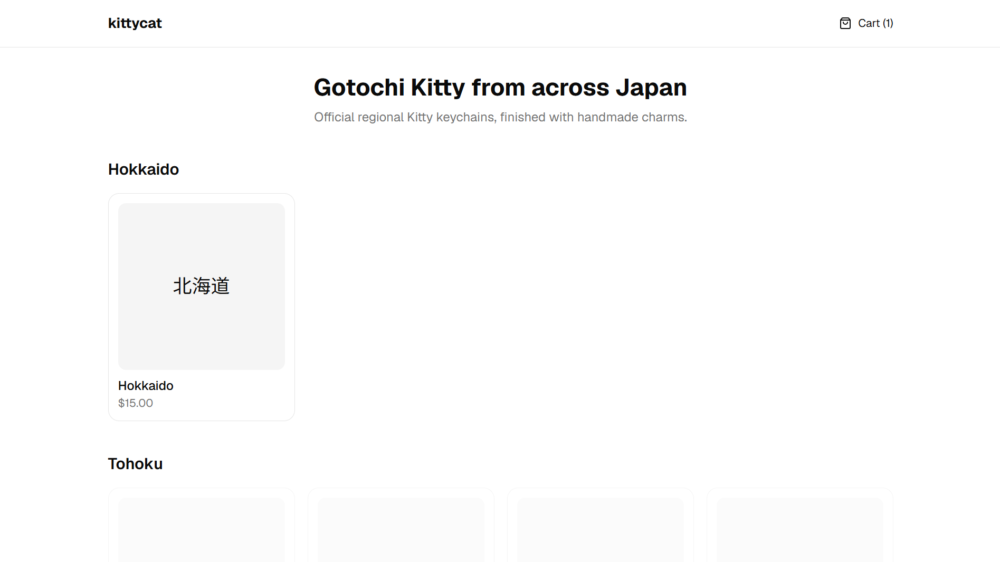
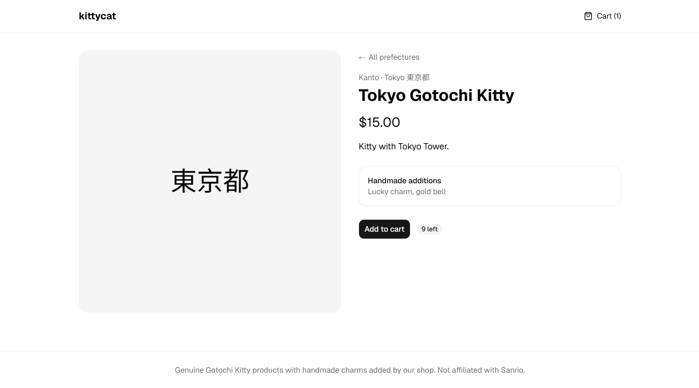
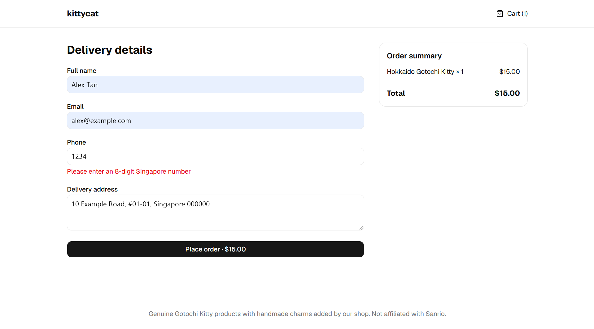
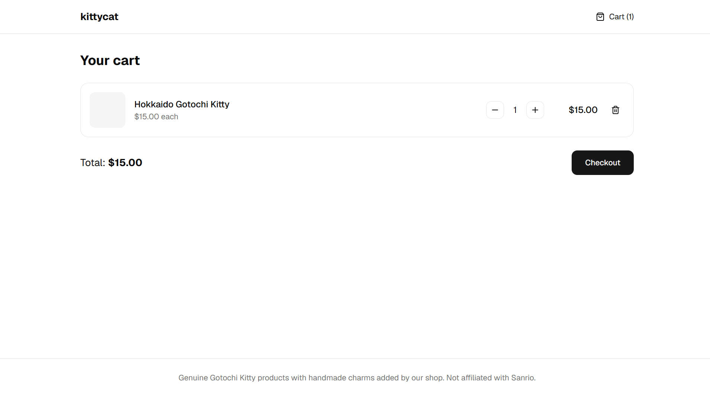
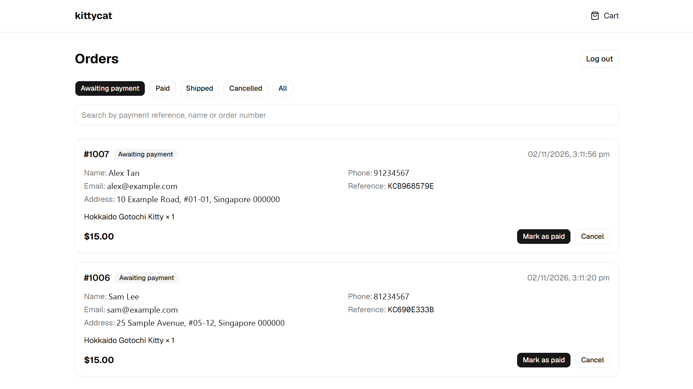
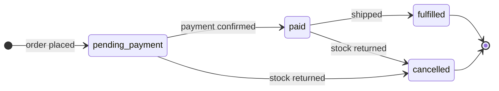
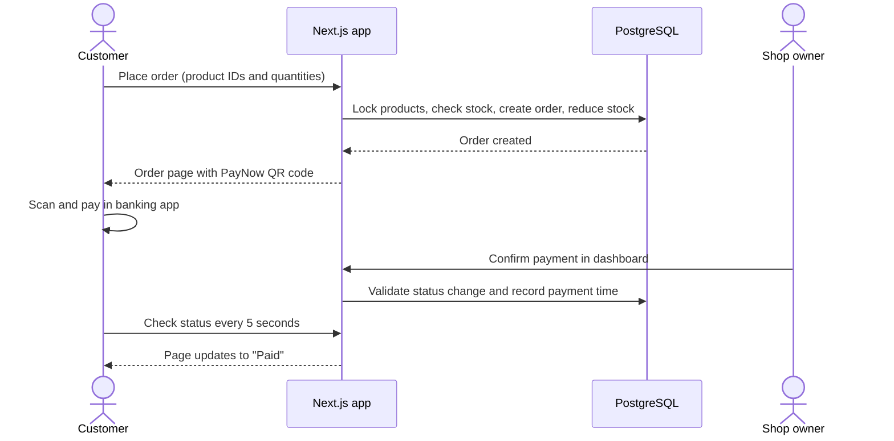

# Kittycat

**A full-stack online shop with QR payments, live stock control and an order management dashboard.**

**[View the live site](https://kitty-gotochi.vercel.app/)**

Kittycat is an online shop for regional Japanese keychains, built for customers in Singapore. Customers browse by prefecture, check out without creating an account and pay by scanning a PayNow QR code. The shop owner then manages each order from a private dashboard, from payment through to delivery.

I built it to solve the problems that make real commerce hard: two people buying the last item at the same moment, prices that can't be tampered with, and order records that stay accurate over time.

**Status:** deployed and in active development, ahead of opening to customers.



| Product page | Checkout |
| :---: | :---: |
|  |  |

| Cart | Order dashboard |
| :---: | :---: |
|  |  |

## Features

**For customers**

- Browse products by prefecture, grouped by region, with stock shown as it stands
- Keep a cart between visits, with no account needed
- Get clear form errors before submitting, and a specific message if an item sells out during checkout
- Pay by scanning a QR code that fills in the amount and payment reference automatically
- Follow the order on its own page, which updates by itself once payment is confirmed

**For the shop owner**

- Sign in to a private dashboard restricted to approved admin accounts
- Filter orders by status and search by payment reference, customer name or order number
- Move orders through payment, shipping or cancellation, with stock returned automatically on cancellation

## Tech stack

| Area | Tools |
| --- | --- |
| Framework | Next.js 16 (App Router), React 19, TypeScript |
| Database | PostgreSQL on Supabase, queried with hand-written SQL through [postgres.js](https://github.com/porsager/postgres) |
| Authentication | Supabase Auth with cookie-based server sessions |
| Interface | Tailwind CSS 4, shadcn/ui, Base UI |
| Payments | PayNow QR (SGQR / EMVCo format), with the payload built in-house |

## Engineering decisions

### Overselling is prevented at the database level

Order creation runs in a single database transaction. It locks the product rows with `SELECT ... FOR UPDATE`, checks stock, writes the order and reduces stock. If two customers try to buy the last item at once, the second waits for the first to finish, then sees an accurate sold-out message. If any step fails, nothing is saved.

See [`app/api/orders/route.ts`](app/api/orders/route.ts).

### The server decides what things cost

The browser sends only product IDs and quantities. Prices and totals are read from the database when the order is placed, so editing a request can't change what a customer pays. All amounts are stored as whole cents to avoid floating-point rounding errors.

### Past orders stay accurate

Each order line keeps its own copy of the product name and unit price, so later catalogue changes don't alter past orders.

### Order status can only change in valid ways

Allowed status changes are defined in one place and enforced on the server. The order row is locked during each update, so a double click or two admins acting at once can't apply conflicting changes.



See [`app/api/admin/orders/[id]/route.ts`](app/api/admin/orders/%5Bid%5D/route.ts).

### Payment QR codes follow the banking standard

[`lib/paynow.ts`](lib/paynow.ts) builds the SGQR / EMVCo payload directly, including its tag-length-value fields and CRC16 checksum. The amount is locked, and each order carries a random reference that the owner can match against bank records. A QR library is used only to draw the final image.

### Admin access is checked on the server, every time

Being signed in isn't enough. A user must also appear in an `admins` table, and that check runs on the server for the dashboard page and for every admin API request. Logged-out visitors are redirected before any dashboard content is sent, and admin pages are excluded from search engines.

Customers don't have accounts, so each order page sits behind a random UUID rather than a guessable order number.

### Validation rules are shared

The checkout form and the orders API use the same rules from [`lib/checkout.ts`](lib/checkout.ts). Customers get instant feedback in the browser, while the server still checks every request independently.

## How an order works



## Project structure

```text
app/
  page.tsx             Storefront
  products/[slug]/     Product page
  cart/, checkout/     Cart and checkout
  orders/[id]/         Order status and PayNow QR code
  admin/               Login and order dashboard
  api/                 Public and admin API routes
components/            Cart state, status polling and shared UI
lib/
  checkout.ts          Shared validation
  paynow.ts            PayNow QR payload builder
  queries.ts           Catalogue and order queries
  admin-auth.ts        Admin access check
  supabase/            Browser and server auth clients
```

## Data model

| Table | Purpose |
| --- | --- |
| `prefectures` | Regions and prefectures, with English and Japanese names |
| `products` | Catalogue, price in cents, stock and active status |
| `orders` | Customer details, total, payment reference, status and payment time |
| `order_items` | Items in each order, with the name and price at the time of purchase |
| `admins` | Supabase user IDs allowed to use the dashboard |

## Running locally

You'll need a current Node.js LTS release and a Supabase project containing the tables above.

```bash
git clone https://github.com/Jaydenbong/kitty-gotochi.git
cd kitty-gotochi
npm install
```

Create a `.env.local` file:

```bash
NEXT_PUBLIC_SUPABASE_URL=            # Supabase project URL
NEXT_PUBLIC_SUPABASE_PUBLISHABLE_KEY= # Supabase publishable key
DATABASE_URL=                        # PostgreSQL connection string
PAYNOW_PROXY_TYPE=mobile             # mobile or uen
PAYNOW_PROXY_VALUE=                  # Mobile number or UEN that receives payment
PAYNOW_MERCHANT_NAME=                # Name shown in the banking app
```

Then start the app:

```bash
npm run dev
```

The site runs at <http://localhost:3000>. To use the dashboard at `/admin`, create a user in Supabase Auth and add that user's ID to the `admins` table.

## What I'd build next

- **Automated tests** for the order transaction, status rules and QR payload
- **Automatic payment matching**, since the owner currently confirms each PayNow payment by hand
- **Expiry for unpaid orders**, since unpaid orders hold their stock until they're cancelled
- **Email confirmations** for order and shipping updates
- **Rate limiting** on the public orders endpoint

---

Built by [Jaydenbong](https://github.com/Jaydenbong). Kittycat is an independent project and is not affiliated with Sanrio.
